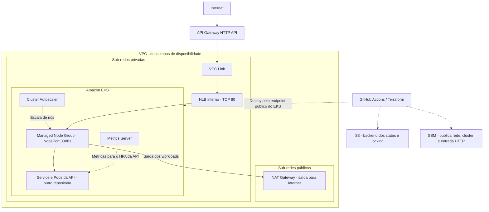

# Oficina — Infraestrutura Kubernetes

Terraform da plataforma AWS: VPC, EKS, Metrics Server, Cluster Autoscaler, NLB privado, VPC Link e API Gateway. Inclui o bootstrap do backend S3 e das variáveis do GitHub para os quatro repositórios. É a primeira infraestrutura a ser implantada.

## Contexto e objetivo

A oficina precisa manter o atendimento disponível durante o crescimento da demanda: cadastro, diagnóstico, aprovação de orçamento e execução dependem do acesso à API. Criar rede e cluster manualmente dificulta reproduzir ambientes e recuperar uma implantação.

Este repositório transforma a plataforma em código Terraform e prepara os contratos usados pelos outros três componentes. A aplicação usa essa capacidade para atender picos de requisições, enquanto banco e autenticação compartilham uma rede privada e uma entrada HTTP controlada.

## Navegação

Os guias abaixo complementam este README com instruções de execução, configuração e diagnóstico.

**Guias e documentos complementares**

- [Instalação das ferramentas](https://github.com/tc-organization-26/gestao-oficina-tc-1/blob/main/docs/INSTALACAO-FERRAMENTAS.md) — instalar ferramentas e conferir o ambiente.
- [Conta AWS comum](docs/CONTA-AWS-COMUM.md) — preparar IAM, OIDC e adaptar a execução fora do Academy.
- [Validação local e execução manual](docs/VALIDACAO-E-EXECUCAO-MANUAL.md) — validação e execução pelo terminal.
- [Execução no laboratório AWS](docs/EXECUCAO-LAB-AWS.md) — checklist GitHub, dependências, deploy e destroy.
- [Tecnologias e versões](docs/VERSOES.md) — tecnologias, ferramentas, versões e fontes.
- [Troubleshooting](docs/TROUBLESHOOTING.md) — diagnóstico por assunto e recuperação.

**Seções deste README**

- [Valor para o projeto](#valor-para-o-projeto)
- [Execução e deploy](#execução-e-deploy)
- [Arquitetura](#arquitetura)
- [Escalabilidade e disponibilidade](#escalabilidade-e-disponibilidade)
- [Caminho da implantação](#caminho-da-implantação)
- [Terraform e contratos SSM](#terraform-da-plataforma)
- [Validação integrada](#validação-integrada)
- [Troubleshooting](#troubleshooting)

## Valor para o projeto

- rede e cluster reproduzíveis para homologação e produção;
- nós privados e entrada da aplicação pelo API Gateway;
- capacidade ajustável para a API por meio de HPA e Cluster Autoscaler;
- descoberta de recursos via SSM, evitando copiar IDs entre projetos;
- states por componente e ambiente, com backend S3 e locking;
- automação da implantação e acompanhamento pelo GitHub Actions.

## Responsabilidades deste repositório

- preparar o bucket S3 dos states e distribuir as variáveis GitHub dos quatro repositórios pelo bootstrap;
- provisionar VPC, sub-redes públicas e privadas, Internet Gateway e NAT Gateway;
- criar o EKS e seu Managed Node Group usando a role configurada;
- instalar Metrics Server e Cluster Autoscaler;
- criar NLB privado, VPC Link e API Gateway HTTP API;
- publicar no SSM os identificadores consumidos pelo banco, pela autenticação e pela aplicação.

## Repositórios da solução

| Repositório | Responsabilidade |
| --- | --- |
| [gestao-oficina-tc-1](https://github.com/tc-organization-26/gestao-oficina-tc-1#readme) | API Java, migrations, Docker Compose e deploy da aplicação |
| [oficina-k8s-infra](https://github.com/tc-organization-26/oficina-k8s-infra#readme) | Bootstrap, rede, EKS, escalabilidade e entrada HTTP |
| [oficina-db-infra](https://github.com/tc-organization-26/oficina-db-infra#readme) | RDS PostgreSQL privado, backups e credencial gerenciada |
| [oficina-auth-lambda](https://github.com/tc-organization-26/oficina-auth-lambda#readme) | Login por CPF, JWT e rotas protegidas do Gateway |

## Execução e deploy

### Validação local e execução manual

Consulte o [guia de validação local e execução manual](docs/VALIDACAO-E-EXECUCAO-MANUAL.md) para validar o Terraform e executar bootstrap, plan e apply pelo terminal. A validação exige Terraform compatível e PowerShell para o patch do módulo EKS; o primeiro init pode baixar providers e módulos.

Este repositório não cria um cluster Kubernetes local. Executar plan/apply no computador continua acessando a AWS e exige o mesmo backend e ambiente da esteira.

### Deploy e execução no laboratório AWS

Prepare o [checklist de acessos e configurações](docs/EXECUCAO-LAB-AWS.md#checklist-inicial) e conclua as dependências na [ordem de implantação](docs/EXECUCAO-LAB-AWS.md#ordem-da-primeira-implantação). Faça o merge para `homologacao` para disparar o deploy em `hom` e aguarde a conclusão. Para produção, use `main` após validar homologação. **Run workflow é uma alternativa ou reexecução**, não um passo obrigatório após o merge.

> O código contém adaptações educacionais de IAM e credenciais. Confira a observação do guia AWS antes de utilizá-lo em outra conta.

Na primeira instalação, execute manualmente `bootstrap.yml` antes do deploy da plataforma. Ele prepara S3 e registra as variáveis `AWS_REGION`, `TF_STATE_BUCKET` e `LAB_ROLE_ARN`; não distribui os secrets AWS, JWT, GHCR ou Datadog. Depois da plataforma, implante banco, autenticação e aplicação em sequência.

### Acompanhamento dos deploys

Consulte as [execuções do Actions](https://github.com/tc-organization-26/oficina-k8s-infra/actions) para acompanhar as implantações de homologação e produção e acessar a URL do API Gateway no resumo do workflow.

A URL também fica no resumo da execução e no output `api_gateway_url`; pode mudar entre ambientes e recriações. As rotas dependem dos deploys da autenticação e da aplicação.

Este repositório provisiona infraestrutura com Terraform. A imagem da aplicação é construída no repositório da Oficina API.

## Arquitetura



Consulte os [recursos principais](#recursos-principais) deste componente. A [arquitetura integrada da aplicação](https://github.com/tc-organization-26/gestao-oficina-tc-1/blob/main/docs/ARQUITETURA-SOLUCAO.md) reúne os quatro projetos e suas sequências.

## Arquitetura provisionada

Os nós do EKS ficam em sub-redes privadas. O endpoint do EKS permanece público para permitir a administração e o deploy pelo GitHub Actions. A aplicação é exposta externamente somente pelo API Gateway.

O Gateway, o VPC Link e a integração HTTP da aplicação são criados aqui. As rotas públicas de login/saúde e as rotas protegidas pelo Authorizer são criadas pelo repositório de autenticação. A [visão integrada de componentes](https://github.com/tc-organization-26/gestao-oficina-tc-1/blob/main/docs/ARQUITETURA-SOLUCAO.md#diagrama-de-componentes-da-aplicação) inclui banco, autenticação e monitoramento.

## Escalabilidade e disponibilidade

| Mecanismo | Papel na operação | Limite atual |
| --- | --- | --- |
| HPA da aplicação | Ajusta Pods de 2 a 6 réplicas por CPU e memória | Manifest mantido no repositório da API; depende de requests e métricas disponíveis |
| Metrics Server | Fornece métricas de recursos ao HPA | Não substitui a observabilidade de logs, traces e negócio |
| Cluster Autoscaler | Ajusta a quantidade de nós para acomodar workloads | Node group configurado com mínimo 1, desejado 2 e máximo 4 por padrão |
| Rede em duas AZs | Oferece sub-redes em zonas distintas | Não garante, por si só, distribuição de réplicas ou disponibilidade de todas as dependências |
| NAT Gateway | Permite saída dos workloads privados | Um NAT por padrão; a saída depende dele |
| RDS | Mantém a persistência fora do ciclo de vida dos Pods | Provisionado por outro repositório, com `multi_az=false` por padrão |

Os mecanismos de escala apoiam os horários de pico, mas sua capacidade precisa ser observada durante o uso. Quantidade de réplicas, limites de nós e saúde do banco devem ser avaliados em conjunto; a configuração atual não equivale a uma garantia de alta disponibilidade ponta a ponta.

## Caminho da implantação

```text
Configurar acessos e secrets dos quatro repositórios
  → executar bootstrap.yml: bucket S3 e variables compartilhadas
  → implantar plataforma: rede, EKS, escalabilidade e entrada HTTP
  → implantar RDS: instância privada e parâmetros do banco
  → implantar autenticação: Lambdas, chave JWT, Authorizer e rotas
  → implantar API: imagem GHCR, Flyway, workloads e observabilidade
  → reexecutar autenticação para ativar Datadog após o secret compartilhado
  → validar readiness, login e fluxo de ordem de serviço
```

Execute cada etapa no mesmo ambiente e aguarde sua conclusão antes da próxima. As esteiras não disparam os outros repositórios. O Gateway provisionado aqui só passa a atender os caminhos da aplicação depois que autenticação e API estiverem implantadas.

O [guia AWS](docs/EXECUCAO-LAB-AWS.md) contém pré-requisitos, comandos e ordem de remoção. Para desenvolvimento do negócio no computador, use o Docker Compose do repositório da aplicação; executar Terraform localmente continua provisionando recursos AWS.

## Recursos principais

| Componente | Implementação |
| --- | --- |
| Rede | VPC em duas Availability Zones |
| Sub-redes | Duas públicas e duas privadas |
| Saída privada | Um NAT Gateway quando `enable_nat_gateway = true` |
| Kubernetes | Amazon EKS |
| Compute | EKS Managed Node Group `ON_DEMAND` |
| Storage add-on | AWS EBS CSI Driver |
| Escala de Pods | Metrics Server + HPA definido no repositório da aplicação |
| Escala de nós | Cluster Autoscaler usando a `LabRole` dos nodes |
| Entrada privada | Network Load Balancer |
| Entrada pública | API Gateway HTTP API + VPC Link |
| Descoberta entre repositórios | AWS Systems Manager Parameter Store |

## Acesso à API

Este repositório provisiona infraestrutura e não expõe uma API de negócio própria. A documentação e as requisições da aplicação consumidora estão disponíveis em:

- [Swagger local da Oficina API](http://localhost:8081/swagger-ui/index.html), após iniciar a aplicação.
- [Collection Insomnia](https://github.com/tc-organization-26/gestao-oficina-tc-1/blob/main/src/main/resources/insomnia/collection.yaml): inclui o login por CPF da Lambda (`POST /auth/login`) e os fluxos de negócio da API.

## Infraestrutura e integração entre os repositórios

Este Terraform cria rede, cluster e integração HTTP. A autenticação acrescenta as rotas públicas e protegidas ao Gateway; a aplicação publica o Service NodePort `30081` e os Pods.

Os parâmetros ficam sob `/oficina/ENV/network`, `/oficina/ENV/eks` e `/oficina/ENV/edge`. A plataforma usa `oficina/k8s/hom.tfstate` ou `oficina/k8s/prod.tfstate`; os demais componentes mantêm seus próprios states. Consulte as [variáveis, outputs e contratos SSM](#terraform-da-plataforma).

## Estrutura do repositório

| Arquivo ou diretório | Responsabilidade |
| --- | --- |
| [main.tf](main.tf) | VPC, EKS, add-ons e Managed Node Group |
| [edge.tf](edge.tf) | NLB, VPC Link, Gateway, integração e parâmetros SSM |
| [autoscaling.tf](autoscaling.tf) | Releases Helm do Metrics Server e Cluster Autoscaler |
| [variables.tf](variables.tf), [versions.tf](versions.tf) e [outputs.tf](outputs.tf) | Entradas, providers e dados publicados pelo Terraform |
| [terraform.tfvars.example](terraform.tfvars.example) | Exemplo inicial para aplicação pelo terminal |
| [scripts/bootstrap-lab.ps1](scripts/bootstrap-lab.ps1) | Bootstrap atual de S3, role preexistente e variáveis GitHub |
| [scripts/patch-eks-module-for-lab.ps1](scripts/patch-eks-module-for-lab.ps1) | Adaptação do módulo EKS ao ambiente educacional |
| [.github/workflows](.github/workflows) | Bootstrap manual, validação, deploy e promoção |
| [bootstrap/](bootstrap) e [scripts/bootstrap.ps1](scripts/bootstrap.ps1) | Implementação anterior de bootstrap/OIDC, fora do workflow atual |

## Terraform da plataforma

### Variáveis

| Variável | Padrão | Descrição |
| --- | --- | --- |
| `aws_region` | `us-east-1` | Região AWS |
| `lab_role_arn` | Obrigatória, sem padrão | ARN da LabRole preexistente |
| `project_name` | `oficina` | Prefixo dos recursos e parâmetros |
| `environment` | `dev` | Sufixo do ambiente |
| `vpc_cidr` | `10.20.0.0/16` | CIDR da VPC |
| `cluster_version` | `1.34` | Versão do Kubernetes no EKS |
| `node_instance_types` | `["t3.medium"]` | Tipos de instância do node group |
| `node_min_size` | `1` | Quantidade mínima de nós |
| `node_desired_size` | `2` | Quantidade desejada |
| `node_max_size` | `4` | Quantidade máxima |
| `enable_nat_gateway` | `true` | Habilita NAT Gateway |
| `app_node_port` | `30081` | NodePort fixo da aplicação |

O arquivo `terraform.tfvars.example` contém valores iniciais; informe também `lab_role_arn` e escolha explicitamente o ambiente ao aplicar. Não versione `terraform.tfvars` com valores sensíveis ou específicos da conta.

### Outputs

- `cluster_name`
- `vpc_id`
- `private_subnet_ids`
- `api_gateway_url`
- `application_nlb_dns`

### Parâmetros publicados no SSM

Para cada ambiente são criados:

```text
/oficina/ENV/edge/http-api-id
/oficina/ENV/edge/http-api-execution-arn
/oficina/ENV/edge/app-integration-id
/oficina/ENV/network/vpc-id
/oficina/ENV/network/private-subnet-ids
/oficina/ENV/eks/cluster-name
/oficina/ENV/eks/node-security-group-id
```

`ENV` é `hom` para homologação e `prod` para produção.

## Validação após o deploy

Confirme os nós EKS, os workloads de escalabilidade e os parâmetros SSM conforme o [roteiro de validação](docs/EXECUCAO-LAB-AWS.md#validar-a-plataforma). Os outputs incluem `cluster_name`, `vpc_id`, `private_subnet_ids`, `api_gateway_url` e `application_nlb_dns`.

O Gateway pode ainda não responder às rotas da aplicação: elas dependem dos deploys da autenticação e da API. Para diagnóstico, consulte [EKS e acesso](docs/TROUBLESHOOTING.md#eks-nós-e-acesso-kubernetes) ou [rede, NLB e Gateway](docs/TROUBLESHOOTING.md#rede-nlb-e-api-gateway).

## Validação integrada

Após a [validação da plataforma](docs/EXECUCAO-LAB-AWS.md#validar-a-plataforma), confira a solução completa:

1. Os nós estão `Ready`, e Metrics Server e Cluster Autoscaler estão em execução.
2. A aplicação concluiu o rollout no namespace `oficina`, o Service usa NodePort `30081` e o HPA encontra métricas após a coleta inicial.
3. O readiness público pelo Gateway retorna `status=UP`, indicando prontidão da API e do banco.
4. O login por CPF retorna JWT, e uma chamada autenticada a `/clientes` é aceita.
5. O [roteiro de negócio da API](https://github.com/tc-organization-26/gestao-oficina-tc-1/blob/main/docs/VALIDACAO-FLUXO.md) percorre diagnóstico, orçamento, execução, pagamento e entrega.

A disponibilidade do cluster sozinha não comprova o funcionamento das rotas, das migrations ou das operações da oficina. Use os guias de diagnóstico dos componentes envolvidos se uma dessas etapas falhar.

## Observabilidade

Metrics Server fornece métricas ao HPA da API, e Cluster Autoscaler ajusta a capacidade dos nós. Datadog Operator/Agent, dashboards e alertas são instalados pelo deploy da aplicação, não por este Terraform. Consulte a [observabilidade da Oficina API](https://github.com/tc-organization-26/gestao-oficina-tc-1/blob/main/docs/OBSERVABILIDADE.md) para a coleta integrada.

## Executando destroy

Remova a plataforma depois da aplicação/observabilidade, autenticação e RDS, conforme o [procedimento de destroy](docs/EXECUCAO-LAB-AWS.md#executando-destroy). Preserve os states até concluir as dependências. O bucket foi criado pelo bootstrap via AWS CLI e não é destruído pelo Terraform da plataforma.

## Workflow

- [Workflow de bootstrap](.github/workflows/bootstrap.yml) e [histórico de execuções](https://github.com/tc-organization-26/oficina-k8s-infra/actions/workflows/bootstrap.yml).
- [Workflow Terraform](.github/workflows/terraform.yml) e [histórico de execuções](https://github.com/tc-organization-26/oficina-k8s-infra/actions/workflows/terraform.yml).

### Fluxo de branches

`fase-3` valida e abre PR para `homologacao`; `homologacao` faz deploy em `hom` e abre PR para `main`; `main` faz deploy em `prod`. Os merges são manuais. Executar manualmente em `fase-3` também só valida. Consulte [branches e ambientes](docs/EXECUCAO-LAB-AWS.md#branches-e-ambientes).

## Troubleshooting

Consulte o [guia de diagnóstico deste componente](docs/TROUBLESHOOTING.md) para sintomas, comandos de verificação e correções por assunto. O guia também referencia os demais componentes quando a falha atravessa rede, banco, autenticação ou aplicação.
